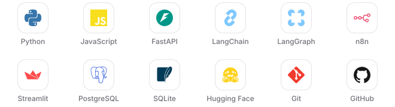

<h1 align="center">Hi, I'm Vishesh 👋</h1>

  <picture>
    <source media="(prefers-color-scheme: dark)" srcset="assets/typing-dark.svg">
    
  </picture>

  AI &amp; GenAI Engineer · B.Tech CSE (AI &amp; ML) · Indore, India

  <a href="https://www.linkedin.com/in/visheshbpatel"><picture>
    <source media="(prefers-color-scheme: dark)" srcset="assets/btn-linkedin-dark.svg">
    
  </picture></a>&nbsp;&nbsp;<a href="mailto:visheshpatel599@gmail.com"><picture>
    <source media="(prefers-color-scheme: dark)" srcset="assets/btn-email-dark.svg">
    
  </picture></a>
  <!-- Add when the portfolio is ready to share:
  &nbsp;&nbsp;<a href="https://visheshbpatel.vercel.app/"><picture>
    <source media="(prefers-color-scheme: dark)" srcset="assets/btn-portfolio-dark.svg">
    
  </picture></a>
  -->

### about me

- I build LLM agents with retrieval, REST APIs and workflow automations, and ship them end to end, from authentication and storage to deployment.
- Most into agentic AI, RAG, and the backend engineering that makes AI features dependable.
- On my list: rebuilding SynapseAI's backend as a FastAPI service.
- Available for AI/ML, GenAI and software engineering roles.

### what i've built

<table>
  <tr>
    <td valign="top" width="33%">
      <b><a href="https://github.com/visheshbpatel/synapse-ai">SynapseAI</a></b> 
      Chat with your own documents. A LangGraph agent with RAG and cited sources.  
      LangGraph · Chroma · Streamlit 
      <a href="https://github.com/visheshbpatel/synapse-ai">Repo</a> · <a href="https://synapse-ai-vbp.streamlit.app/">Live demo</a>
    </td>
    <td valign="top" width="33%">
      <b><a href="https://github.com/visheshbpatel/karya">Karya</a></b> 
      A task manager with email OTP sign-up, JWT auth and 80+ tests, on a FastAPI backend.  
      FastAPI · PostgreSQL · pytest 
      <a href="https://github.com/visheshbpatel/karya">Repo</a> · <a href="https://karya-9bym.onrender.com/">Live demo</a>
    </td>
    <td valign="top" width="33%">
      <b><a href="https://github.com/visheshbpatel/sarthi">Sarthi</a></b> 
      A personal assistant on an n8n agent workflow, across Gmail, Calendar, Tasks, Docs and Sheets.  
      n8n · Streamlit · Google Workspace 
      <a href="https://github.com/visheshbpatel/sarthi">Repo</a>
    </td>
  </tr>
</table>

### tools i use

  <picture>
    <source media="(prefers-color-scheme: dark)" srcset="assets/tools-dark.svg">
    
  </picture>

### say hello

Have a project in mind, a role to fill, or a question about anything here? I'd like to hear about it.
[Email](mailto:visheshpatel599@gmail.com) · [LinkedIn](https://www.linkedin.com/in/visheshbpatel)

Thanks for stopping by ✨

<!--
Profile views counter (hidden for now). To show it, delete the comment markers around this block.

  

-->
